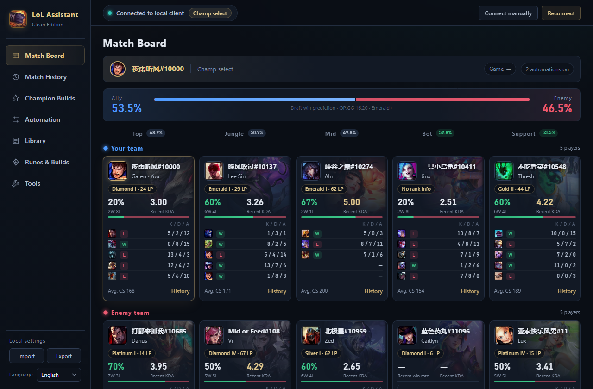
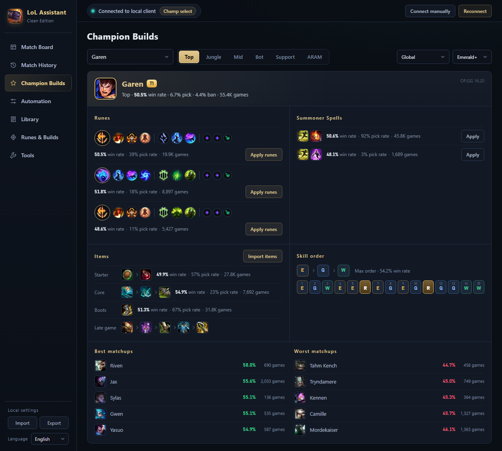
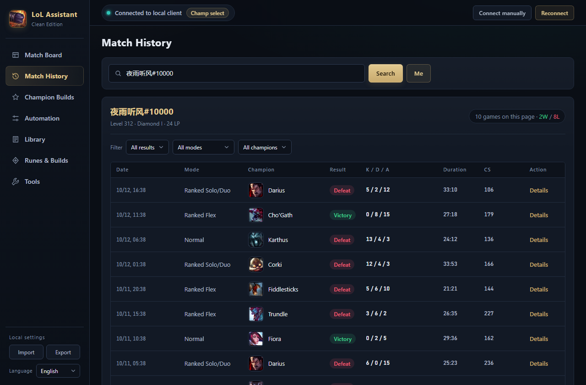

# LoL Clean Assistant

[简体中文](README.md) | **English** | [한국어](README.ko.md)

A League of Legends desktop assistant that talks only to the client on your own PC: match board, match history, recommended builds, draft win prediction, auto-accept and auto-pick, and rune / item set presets.

- No account, no data collection, no ads, no cloud service
- Game data is read straight from your client and updates automatically with each patch
- Recommended builds and win rates come from OP.GG; one switch turns them off and the app goes fully offline
- Interface in English, 한국어 and 简体中文



## Features

| Feature | Description |
|---|---|
| **Match Board** | During champ select and in game, shows all 10 players lined up by position: rank, recent win rate, KDA and last 5 games, over champion splash art |
| **Draft win prediction** | Once both teams are locked in, estimates your team's win rate and shows the matchup win rate for each lane; hidden enemy positions are inferred from each champion's usual role |
| **Recommended builds** | In champ select, shows runes, summoner spells, items and skill order for your champion and applies them to the client in one click; the Champion Builds page looks up any champion |
| **Match History** | Searches recent games by summoner name or Riot ID, filters by result, mode and champion, and shows every player in a game |
| **Automation** | Auto-accept, auto-start queue, play again after a game, and auto-hover / ban champions by per-position priority |
| **Library** | Champion abilities, items, runes, summoner spells, augments, TFT units / items / traits |
| **Runes & item sets** | Edit and save your own rune pages and item sets, apply them to the client or import them into the in-game shop |
| **Tools** | Read and edit game settings and key bindings, change your status and message, create lobbies, import / export settings |
| **Languages** | 简体中文 / English / 한국어, switchable at the bottom left; follows the system language on first launch. Champion, item, rune and spell names and descriptions switch too |

<table>
<tr>
<td></td>
<td></td>
</tr>
<tr>
<td align="center">Champion Builds</td>
<td align="center">Match History</td>
</tr>
</table>

## Download and use

1. Download the latest `lol-clean-assistant-*-win-x64.zip` from [Releases](../../releases) and extract it anywhere
2. Run `联盟助手.exe`
3. Open and sign in to the League client and the assistant connects automatically. If it doesn't, click **Connect manually** at the top right and select the `lockfile` in the client's install folder
4. Change the language at the bottom left if needed

Requirements: Windows 10 / 11 x64.

Settings, presets and synced game data are stored in `clean-data/` inside the program folder. The whole folder is portable; delete `clean-data/` to reset.

## Data and privacy

| Data | Source | Uses the internet |
|---|---|---|
| Games, history, ranks, rune pages, item sets | The League client on this PC (LCU, `127.0.0.1`) | No |
| Champion, item, rune and summoner spell data | The client's own game data, synced when the patch changes; a bundled offline snapshot otherwise | No |
| Recommended builds, champion / matchup win rates | OP.GG (`lol-api-champion.op.gg`) | Yes, can be turned off in **Tools → Data sources** |

- The interface process is completely blocked from the network (CSP + request blocking). All requests are made by the main process, and only to the addresses above.
- Only the champion ID, position, region and rank range are sent to OP.GG. **No account, summoner name or game data is ever sent.**
- Nothing is uploaded to the author or any third-party server.

## How the win prediction works

1. For each lane, it looks at the two champions' head-to-head win rate in that position (OP.GG, usually thousands of games).
2. When there isn't enough matchup data, it uses the difference between the two champions' own win rates in that position.
3. Small samples are pulled toward 50% according to their size, so a handful of games can't produce an extreme result.
4. Players' recent results carry only a very small weight.
5. The five lanes are combined and damped, and the final result is limited to 25%–75%.

A draft explains only a small part of how a game goes, so treat this number **as a reference only**, not a forecast of the result.

## Run from source

Requires [Node.js](https://nodejs.org/) 16 or later. The app runs on Electron 19.1.1 and has no other dependencies.

```bash
git clone https://github.com/xyxycnym/lol-clean-assistant.git
cd lol-clean-assistant
npx electron@19.1.1 resources/app
```

User data is written to `clean-data/` in the repository root (excluded in `.gitignore`).

## Project layout

```
resources/app/
├── main.cjs             # Main process: window, IPC, window size memory
├── preload.cjs          # Restricted API exposed to the interface
├── core/
│   ├── assistant.cjs    # Polling, automation, recommendation and prediction
│   ├── lcu.cjs          # Local client (LCU) connection with an endpoint allowlist
│   ├── gamedata.cjs     # Syncs the latest game data from the client
│   ├── opgg.cjs         # OP.GG data and caching
│   ├── predict.cjs      # Draft win-rate model
│   └── store.cjs        # Reading, writing and validating local settings
└── renderer/
    ├── index.html / app.js / style.css
    ├── i18n.js          # Interface translations (中文 / English / 한국어), shared with the main process
    └── assets/          # Offline data snapshot (JSON + icons); json/en and json/ko hold English and Korean data
```

## Packaging

1. Download `electron-v19.1.1-win32-x64.zip` from [Electron v19.1.1](https://github.com/electron/electron/releases/tag/v19.1.1) and extract it
2. Copy this repository's `resources/app` to `resources/app` in the extracted folder (delete `default_app.asar` there)
3. Rename `electron.exe` to `联盟助手.exe`
4. (Optional) Replace the exe icon with [rcedit](https://github.com/electron/rcedit):

   ```bash
   rcedit-x64.exe 联盟助手.exe --set-icon resources/app/renderer/assets/images/app.ico
   ```

## Notes

- Auto-accept, auto-pick and the other automations use the client's official local API. They don't modify game files or read game memory, but using any third-party tool carries some risk of action from the game operator. Judge that risk for yourself.
- OP.GG data comes from an undocumented API used by their website and may change or stop working at any time. If it does, only recommendations and predictions are affected.
- The bundled data is patch 16.18 for Chinese and 16.20 for English / Korean. Once connected, it updates to the client's patch (when the client language matches the interface language).
- TFT data (units, items, traits) and some augments are currently available in Chinese only.

## Disclaimer

LoL Clean Assistant isn't endorsed by Riot Games and doesn't reflect the views or opinions of Riot Games or anyone officially involved in producing or managing Riot Games properties. Riot Games, and all associated properties are trademarks or registered trademarks of Riot Games, Inc. This project is not affiliated with Tencent or OP.GG.

## License

The source code is released under the [MIT](LICENSE) license. Game images and data in `resources/app/renderer/assets/` are owned by Riot Games and are not covered by the MIT license.
