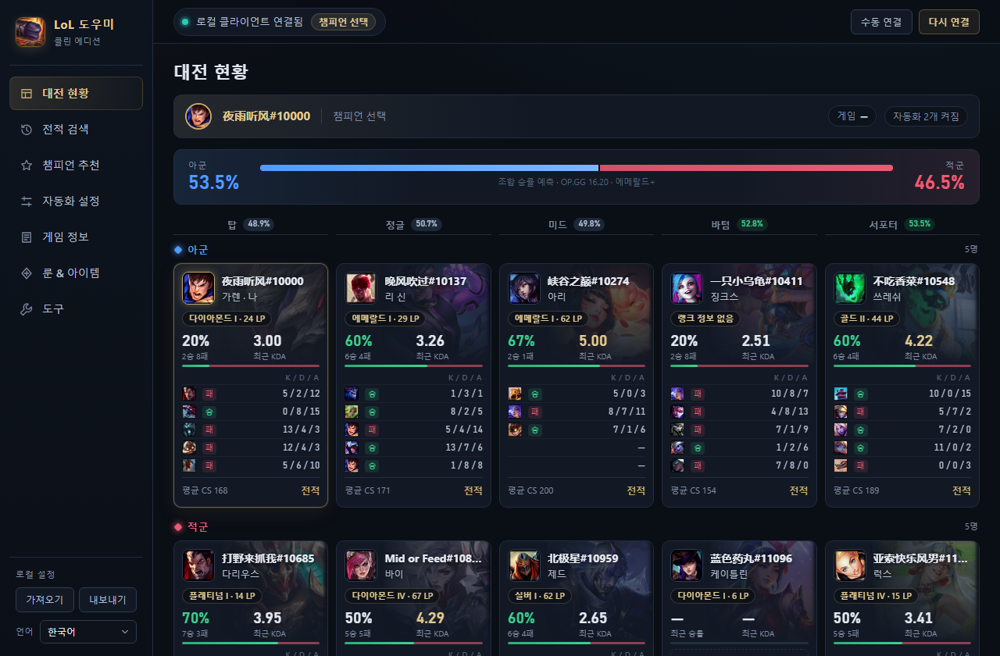
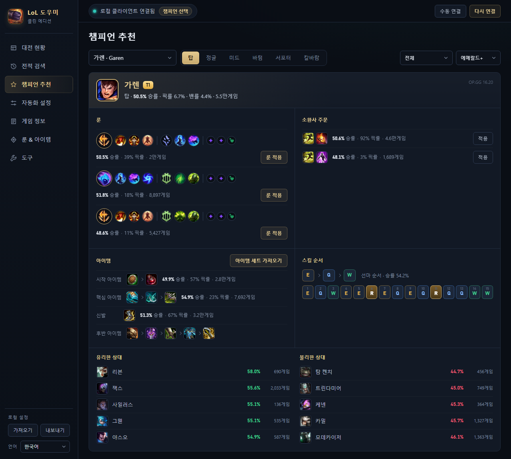
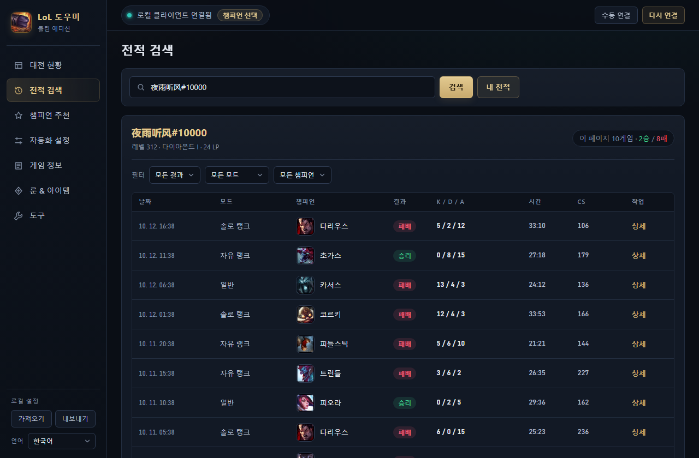

# LoL 클린 도우미

[简体中文](README.md) | [English](README.en.md) | **한국어**

내 PC의 클라이언트에만 연결되는 리그 오브 레전드 데스크톱 도우미입니다. 대전 현황, 전적 검색, 추천 빌드, 조합 승률 예측, 자동 수락과 자동 챔피언 선택, 룬 / 아이템 세트 프리셋 관리를 제공합니다.

- 계정 가입 없음, 데이터 수집 없음, 광고와 클라우드 서비스 없음
- 게임 데이터는 클라이언트에서 직접 읽어 패치마다 자동으로 갱신됩니다
- 추천 빌드와 승률 데이터는 OP.GG에서 가져오며, 끄면 완전히 오프라인으로 동작합니다
- 한국어, English, 简体中文 인터페이스 지원



## 기능

| 기능 | 설명 |
|---|---|
| **대전 현황** | 챔피언 선택과 게임 중에 10명의 플레이어를 포지션별로 정렬해 표시합니다. 티어, 최근 승률, KDA, 최근 5게임을 챔피언 일러스트와 함께 보여 줍니다 |
| **조합 승률 예측** | 양 팀 챔피언이 확정되면 아군 승률을 추정하고 라인별 맞대결 승률을 표시합니다. 적 포지션이 공개되지 않으면 챔피언의 주 포지션으로 추론합니다 |
| **추천 빌드** | 챔피언 선택 중 내 챔피언의 룬, 소환사 주문, 아이템, 스킬 순서를 보여 주고 한 번에 클라이언트에 적용합니다. 챔피언 추천 페이지에서 모든 챔피언을 조회할 수 있습니다 |
| **무작위 총력전: 아수라장 증강 추천** | 아수라장 챔피언 선택 중 내 챔피언에게 가장 잘 맞는 증강을 프리즘 / 골드 / 실버별로 보여 줍니다 (OP.GG 순위). 게임 중 해당 증강이 나오면 바로 고를 수 있습니다 |
| **전적 검색** | 소환사명이나 Riot ID로 최근 게임을 검색하고 결과, 모드, 챔피언으로 필터링하며 게임별 전체 플레이어 정보를 확인합니다 |
| **자동화** | 자동 수락, 자동 대전 찾기, 게임 후 다시 하기, 포지션별 우선순위에 따른 자동 미리 선택 / 금지 |
| **게임 정보** | 챔피언 스킬, 아이템, 룬, 소환사 주문, 증강, TFT 유닛 / 아이템 / 시너지 |
| **룬 & 아이템 세트** | 나만의 룬 페이지와 아이템 세트를 편집·저장하고 클라이언트나 게임 상점에 적용합니다 |
| **도구** | 게임 설정과 단축키 읽기·편집, 접속 상태와 메시지 변경, 로비 만들기, 설정 가져오기 / 내보내기 |
| **다국어** | 简体中文 / English / 한국어. 왼쪽 아래에서 언제든 바꿀 수 있으며, 처음 실행할 때는 시스템 언어를 따릅니다. 챔피언, 아이템, 룬, 소환사 주문의 이름과 설명도 함께 바뀝니다 |

<table>
<tr>
<td></td>
<td></td>
</tr>
<tr>
<td align="center">챔피언 추천</td>
<td align="center">전적 검색</td>
</tr>
</table>

## 다운로드 및 사용

1. [Releases](../../releases)에서 최신 `lol-clean-assistant-*-win-x64.zip`을 내려받아 원하는 위치에 압축을 풉니다
2. `联盟助手.exe`를 실행합니다
3. 리그 오브 레전드 클라이언트를 실행하고 로그인하면 자동으로 연결됩니다. 연결되지 않으면 오른쪽 위의 **수동 연결**을 눌러 클라이언트 설치 폴더의 `lockfile`을 선택하세요
4. 필요하면 왼쪽 아래에서 언어를 바꿉니다

요구 사항: Windows 10 / 11 x64.

설정, 프리셋, 동기화된 게임 데이터는 프로그램 폴더의 `clean-data/`에 저장됩니다. 폴더째로 옮겨서 사용할 수 있고, `clean-data/`를 삭제하면 초기 상태로 돌아갑니다.

## 데이터와 개인정보

| 데이터 | 출처 | 인터넷 사용 |
|---|---|---|
| 게임, 전적, 티어, 룬 페이지, 아이템 세트 | 이 PC의 리그 오브 레전드 클라이언트 (LCU, `127.0.0.1`) | 아니요 |
| 챔피언, 아이템, 룬, 소환사 주문 정보 | 클라이언트에 포함된 게임 데이터 (패치가 바뀌면 동기화), 미연결 시 내장 오프라인 데이터 | 아니요 |
| 추천 빌드, 챔피언 / 맞대결 승률, 아수라장 증강 순위 | OP.GG (`lol-api-champion.op.gg`, `op.gg`) | 예. **도구 → 데이터 출처**에서 끌 수 있습니다 |

- 인터페이스 프로세스는 네트워크 접근이 완전히 차단되어 있습니다 (CSP + 요청 차단). 모든 요청은 메인 프로세스에서만, 위 표의 주소로만 보냅니다.
- OP.GG에는 챔피언 ID, 포지션, 지역, 티어 범위만 보냅니다. **계정, 소환사명, 게임 정보는 절대 보내지 않습니다.**
- 어떤 데이터도 개발자나 제3자 서버로 업로드하지 않습니다.

## 승률 예측 방식

1. 라인마다 두 챔피언이 해당 포지션에서 맞붙었을 때의 승률을 봅니다 (OP.GG, 보통 수천 게임 표본).
2. 맞대결 데이터가 부족하면 두 챔피언이 해당 포지션에서 기록한 승률의 차이를 사용합니다.
3. 표본이 적은 데이터는 크기에 따라 50% 쪽으로 보정해 극단적인 결과를 막습니다.
4. 플레이어의 최근 성적은 아주 작은 비중만 차지합니다.
5. 다섯 라인을 합산한 뒤 전체를 완화하며, 최종 결과는 25%–75%로 제한됩니다.

조합은 게임 결과의 일부만 설명하므로 이 숫자는 **참고용**일 뿐 결과를 예측하지 않습니다.

## 소스에서 실행

[Node.js](https://nodejs.org/) 16 이상이 필요합니다. Electron 19.1.1에서 동작하며 다른 의존성은 없습니다.

```bash
git clone https://github.com/xyxycnym/lol-clean-assistant.git
cd lol-clean-assistant
npx electron@19.1.1 resources/app
```

사용자 데이터는 저장소 루트의 `clean-data/`에 저장됩니다 (`.gitignore`에서 제외됨).

## 폴더 구조

```
resources/app/
├── main.cjs             # 메인 프로세스: 창, IPC, 창 크기 기억
├── preload.cjs          # 인터페이스에 노출하는 제한된 API
├── core/
│   ├── assistant.cjs    # 상태 확인, 자동화, 추천과 예측
│   ├── lcu.cjs          # 로컬 클라이언트 (LCU) 연결, 허용 엔드포인트 목록
│   ├── gamedata.cjs     # 클라이언트에서 최신 게임 데이터 동기화
│   ├── opgg.cjs         # OP.GG 데이터와 캐시
│   ├── predict.cjs      # 조합 승률 모델
│   └── store.cjs        # 로컬 설정 읽기·쓰기·검증
└── renderer/
    ├── index.html / app.js / style.css
    ├── i18n.js          # 인터페이스 번역 (中文 / English / 한국어), 메인 프로세스와 공유
    └── assets/          # 오프라인 데이터 (JSON + 아이콘), json/en·json/ko는 영어·한국어 데이터
```

## 패키징

1. [Electron v19.1.1](https://github.com/electron/electron/releases/tag/v19.1.1)에서 `electron-v19.1.1-win32-x64.zip`을 내려받아 압축을 풉니다
2. 이 저장소의 `resources/app`을 압축 푼 폴더의 `resources/app`으로 복사합니다 (`default_app.asar`는 삭제)
3. `electron.exe`의 이름을 `联盟助手.exe`로 바꿉니다
4. (선택) [rcedit](https://github.com/electron/rcedit)으로 exe 아이콘을 바꿉니다:

   ```bash
   rcedit-x64.exe 联盟助手.exe --set-icon resources/app/renderer/assets/images/app.ico
   ```

## 참고 사항

- 자동 수락, 자동 챔피언 선택 등은 클라이언트의 공식 로컬 API로 동작하며 게임 파일을 수정하거나 게임 메모리를 읽지 않습니다. 다만 서드파티 도구 사용에는 게임 운영사의 제재 가능성이 있으니 직접 판단하세요.
- OP.GG 데이터는 웹사이트가 사용하는 비공개 API에서 가져오므로 언제든 바뀌거나 중단될 수 있습니다. 이 경우 추천과 예측만 영향을 받습니다.
- 내장 데이터는 중국어 16.18, 영어 / 한국어 16.20 패치 기준입니다. 클라이언트에 연결하면 클라이언트 패치로 갱신됩니다 (클라이언트 언어와 인터페이스 언어가 같을 때).
- TFT와 증강의 영어·한국어 데이터는 Riot 공식 데이터로 생성했습니다. 공식 데이터에 없는 소환 유닛 8개(모래 병사 등)와 특수 아이템 5개는 직접 번역했습니다.

## 면책 조항

LoL 클린 도우미는 Riot Games의 보증을 받지 않았으며 Riot Games 또는 Riot Games 자산의 제작·관리에 공식적으로 관여하는 누구의 견해나 의견도 대변하지 않습니다. Riot Games 및 모든 관련 자산은 Riot Games, Inc.의 상표 또는 등록 상표입니다. 이 프로젝트는 Tencent, OP.GG와도 관련이 없습니다.

## 라이선스

소스 코드는 [MIT](LICENSE) 라이선스로 공개됩니다. `resources/app/renderer/assets/`의 게임 이미지와 데이터는 Riot Games 소유이며 MIT 라이선스 범위에 포함되지 않습니다.
