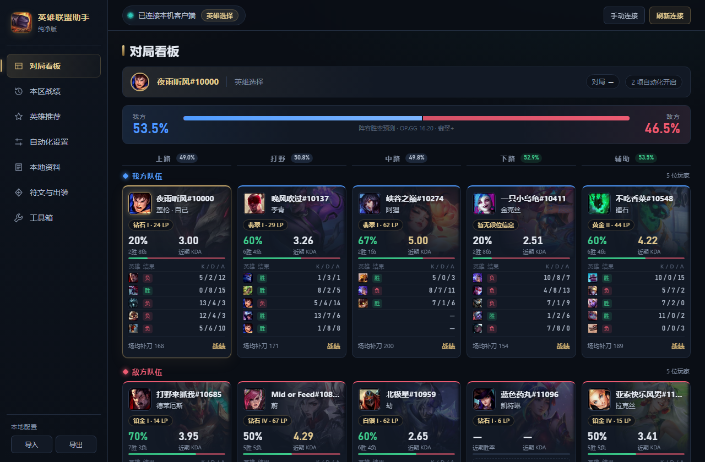
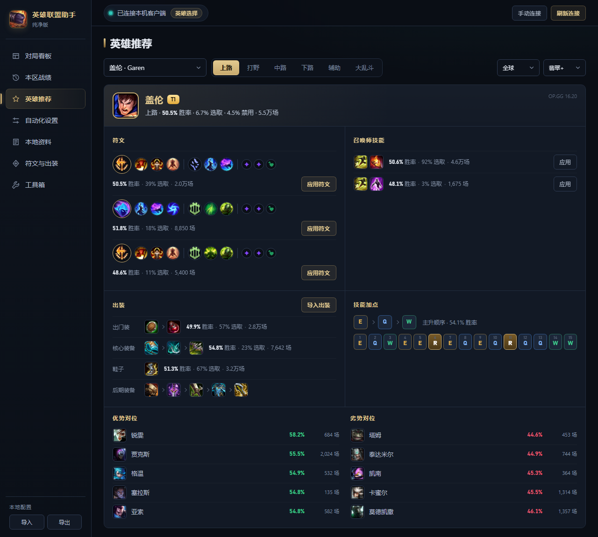
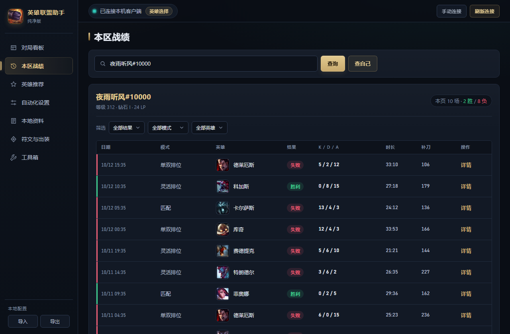

# 英雄联盟助手 · 纯净版

**简体中文** | [English](README.en.md) | [한국어](README.ko.md)

一个只连接本机客户端的英雄联盟桌面助手：对局看板、战绩查询、推荐出装、阵容胜率预测、自动接受与选人，以及符文 / 出装方案管理。

- 不需要注册账号，不收集任何数据，没有广告和云服务
- 游戏数据直接从你的客户端读取，版本更新后自动同步
- 推荐出装与胜率数据来自 OP.GG，可一键关闭，关闭后完全离线
- 界面支持简体中文、English、한국어



## 功能

| 功能 | 说明 |
|---|---|
| **对局看板** | 选人与对局中按分路对齐展示双方 10 名玩家：段位、近期胜率、KDA、最近 5 场战绩，背景为英雄原画 |
| **阵容胜率预测** | 双方英雄确定后，估算我方胜率，并显示每条分路的对位胜率；敌方分路未公开时按英雄常用位置自动推断 |
| **推荐出装** | 选人时自动给出当前英雄的符文、召唤师技能、出装与加点，一键应用到客户端；也可在「英雄推荐」页查询任意英雄 |
| **海克斯大乱斗强化推荐** | 进入海克斯大乱斗选人后，按棱彩 / 黄金 / 白银分组列出最适合当前英雄的海克斯强化（排名来自 OP.GG），开局后随机到时一眼就知道该选哪个 |
| **本区战绩** | 按召唤师名 / Riot ID 查询近期对局，可按胜负、模式、英雄筛选，查看单局全部玩家数据 |
| **自动化** | 自动接受匹配、自动开始匹配、赛后再来一局、按分路优先级自动预选 / 禁用英雄 |
| **本地资料** | 英雄技能、装备、符文、召唤师技能、海克斯、云顶弈子 / 装备 / 羁绊 |
| **符文与出装方案** | 编辑并保存自己的符文页与出装，应用到客户端或导入游戏内商店 |
| **工具箱** | 读写游戏设置与按键、修改在线状态与签名、创建房间、导入导出本地配置 |
| **多语言** | 简体中文 / English / 한국어，左下角随时切换；首次启动跟随系统语言。英雄、装备、符文、召唤师技能名称和说明也会切换为对应语言 |

<table>
<tr>
<td></td>
<td></td>
</tr>
<tr>
<td align="center">英雄推荐</td>
<td align="center">本区战绩</td>
</tr>
</table>

## 下载与使用

1. 在 [Releases](../../releases) 下载最新的 `lol-clean-assistant-*-win-x64.zip`，解压到任意目录（路径中可以有中文）
2. 双击 `联盟助手.exe`
3. 打开并登录英雄联盟客户端，助手会自动连接；如果没有自动连接，点右上角「手动连接」，选择客户端安装目录下的 `lockfile`

系统要求：Windows 10 / 11 x64。

设置、方案和同步下来的游戏数据都保存在程序目录下的 `clean-data/`。整个文件夹可以直接拷走使用；删除 `clean-data/` 即可恢复初始状态。

## 数据与隐私

| 数据 | 来源 | 是否联网 |
|---|---|---|
| 对局、战绩、段位、符文页、出装 | 本机英雄联盟客户端（LCU，`127.0.0.1`） | 否 |
| 英雄、装备、符文、召唤师技能资料 | 本机客户端自带的游戏数据，版本变化时自动同步；未连接时使用内置离线快照 | 否 |
| 推荐出装、英雄 / 对位胜率、海克斯大乱斗强化排名 | OP.GG（`lol-api-champion.op.gg`、`op.gg`） | 是，可在「工具箱 → 数据来源」关闭 |

- 界面进程被完全禁止联网（CSP + 请求拦截），所有网络请求只在主进程中进行，并且只允许访问上表中的地址。
- 向 OP.GG 只发送英雄编号、分路、区域和段位范围，**不发送任何账号、召唤师名或对局信息**。
- 程序不会把任何数据上传到作者或第三方服务器。

## 胜率预测是怎么算的

1. 每条分路先看双方英雄在该分路的历史对位胜率（OP.GG，通常有上千场样本）。
2. 对位数据不足时，用两个英雄各自在该分路的胜率之差代替。
3. 场次少的数据会按样本量向 50% 收缩，避免小样本造成极端结果。
4. 玩家近期战绩只占很小的权重。
5. 五条分路合计后整体打折，最终结果限制在 25%–75%。

阵容只能解释一局比赛的一小部分，这个数字**只适合作为参考**，不代表比赛结果。

## 从源码运行

需要 [Node.js](https://nodejs.org/) 16 或更高版本。程序基于 Electron 19.1.1，没有其他依赖。

```bash
git clone https://github.com/xyxycnym/lol-clean-assistant.git
cd lol-clean-assistant
npx electron@19.1.1 resources/app
```

用户数据会写到仓库根目录的 `clean-data/`（已在 `.gitignore` 中排除）。

## 目录结构

```
resources/app/
├── main.cjs             # 主进程：窗口、IPC、窗口大小记忆
├── preload.cjs          # 向界面暴露的受限接口
├── core/
│   ├── assistant.cjs    # 状态轮询、自动化、推荐与预测调度
│   ├── lcu.cjs          # 本机客户端（LCU）连接，接口白名单
│   ├── gamedata.cjs     # 从客户端同步最新游戏数据
│   ├── opgg.cjs         # OP.GG 数据读取与缓存
│   ├── predict.cjs      # 阵容胜率估算模型
│   └── store.cjs        # 本地设置的读写与校验
└── renderer/
    ├── index.html / app.js / style.css
    ├── i18n.js          # 界面翻译（中文 / English / 한국어），主进程共用
    └── assets/          # 离线资料快照（JSON + 图标），json/en、json/ko 为英文与韩文资料
```

## 打包

1. 下载 [Electron v19.1.1](https://github.com/electron/electron/releases/tag/v19.1.1) 的 `electron-v19.1.1-win32-x64.zip` 并解压
2. 把本仓库的 `resources/app` 复制到解压目录的 `resources/app`（删除其中的 `default_app.asar`）
3. 把 `electron.exe` 改名为 `联盟助手.exe`
4. （可选）用 [rcedit](https://github.com/electron/rcedit) 替换 exe 图标：

   ```bash
   rcedit-x64.exe 联盟助手.exe --set-icon resources/app/renderer/assets/images/app.ico
   ```

## 注意事项

- 自动接受、自动选人等功能通过客户端官方的本地接口实现，不修改游戏文件、不读取游戏内存。但使用任何第三方工具都存在被游戏运营方处理的可能，请自行评估风险。
- OP.GG 数据来自其网站使用的非公开接口，可能随时变化或不可用；不可用时只影响推荐与预测，其他功能照常工作。
- 内置离线资料的版本为中文 16.18、英文 / 韩文 16.20，连接客户端后自动更新为客户端当前版本（客户端语言与界面语言一致时）。
- 云顶之弈与海克斯强化的英文、韩文资料按 Riot 官方数据生成；其中 8 个召唤物（如沙兵）和 5 件特殊装备不在官方数据中，为人工翻译。

## 免责声明

本项目与 Riot Games、腾讯及 OP.GG 均无关联，未获得其认可或赞助。英雄联盟（League of Legends）及相关名称、图标、图片均为 Riot Games, Inc. 的商标或注册商标，相关美术资源的版权归 Riot Games 所有。

League of Legends Clean Assistant isn't endorsed by Riot Games and doesn't reflect the views or opinions of Riot Games or anyone officially involved in producing or managing Riot Games properties. Riot Games, and all associated properties are trademarks or registered trademarks of Riot Games, Inc.

## 许可证

源代码以 [MIT](LICENSE) 许可证开源。`resources/app/renderer/assets/` 中的游戏图片与资料版权归 Riot Games 所有，不在 MIT 授权范围内。
